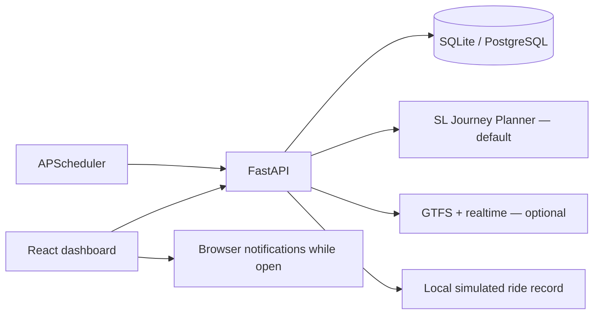

# Commute Companion

A local-first commute dashboard that checks an SL journey before departure and saves a local Uber demo ride simulation when the reported delay exceeds your threshold.

## Setup

1. SL Stockholm route planning works out of the box with no transit API key or static feed. `TRANSIT_PROVIDER=sl` is the default. To use GTFS instead, set `TRANSIT_PROVIDER=gtfs`, obtain access to [Trafiklab GTFS Sweden 3](https://www.trafiklab.se/api/trafiklab-apis/gtfs-sweden-3/) and its GTFS realtime feeds. Set `TRAFIKLAB_API_KEY`, `GTFS_STATIC_URL` (a static GTFS ZIP URL or local file path), and `TRAFIKLAB_OPERATOR` to the appropriate operator feed identifier. The static feed and realtime feed must use compatible IDs.
2. The Uber fallback is a local simulation. It requires no Uber account, API credentials, or API keys and never contacts Uber.
3. Configure `APP_USERNAME` and `APP_PASSWORD` (at least 12 characters) for workspace access. Keep `.env` out of version control. No Uber configuration is needed.
4. Run `docker compose up --build`. Open http://localhost:5173; Swagger is at http://localhost:8000/docs. Data persists in a Docker volume. For a PostgreSQL deployment install a PostgreSQL SQLAlchemy driver and set `DATABASE_URL`.

For local development: create a Python virtual environment, `pip install -r backend/requirements.txt`, then run `uvicorn app.main:app --reload --app-dir backend` from the repository root. In another terminal run `cd frontend && npm install && npm run dev`. Run `PYTHONPATH=backend python backend/seed.py` to create two example rules; restart the backend after seeding.

## Testing the flow

Run `PYTHONPATH=backend pytest backend/tests` and `cd frontend && npm test`. For Stockholm, use the default SL planner. Create a rule, then use **Test check**. The check appears in history. A real-time delay greater than the threshold creates a local simulated Uber demo record; equal or smaller delays do not. The simulation needs no Uber credentials and never requests or schedules a real ride.

## Scope and limitations

- Location autocomplete uses OpenStreetMap through Photon by default, with optional Google Places. The default SL planner covers Stockholm and supports the transfers and walking legs returned by SL. It uses your scheduled date and time and compares estimated departure and arrival with planned times, using the greater delay for the threshold. No-route, cancelled-only, missing-time and missing-estimate results are errors, not all-clear results. For the optional GTFS planner, only direct services within 90 minutes after the requested start (or five minutes before) are supported; its operator must be configured explicitly.
- With `TRANSIT_PROVIDER=gtfs`, GTFS is loaded into memory and refreshed on demand. Realtime responses are cached for 30 seconds, and feeds with old header timestamps are rejected. Missing trip updates are assumed on time and flagged; cancelled trips and feed failures surface as errors. Service alerts are reported as a warning, not interpreted as delay.
- The Uber fallback is a clearly labeled local simulation, modeled on the reference implementation. It records a demo ride when the measured delay exceeds the configured threshold. It makes no Uber API calls and creates no real request, driver, charge, or dispatch. The saved time is the planned commute time; it does not schedule a pickup.
- Browser notifications are delivered by an open dashboard polling every 30 seconds, not Web Push; a closed browser will not receive them. Denied permissions leave results in the dashboard. Email delivery is not implemented.
- This is a shared workspace application with credential access. It has no distributed scheduler coordination, persistent OAuth state, or production-grade rate limiting. Run one backend worker and use HTTPS and durable infrastructure for hosting. Manual test checks are intentionally separate from scheduled idempotency keys and can create additional local demo records.
- DST gaps are normalized forward. Ambiguous autumn times use the first occurrence. Checks are scheduled by absolute lead time before departure; if today's check time has passed, the next eligible occurrence is used.

## Assignment delivery and business outcome

The business problem is repeated manual checking of a commute and arranging a backup when transit is delayed. A scheduled commute agent selects a journey, reads provider estimates, compares the delay to a user threshold, creates a simulated Uber demo ride if needed, and records the decision and notification. The primary transit monitoring workflow is deterministic. When SL cannot find a journey, an optional Gemini step recommends alternative operators for the route. The overview reports checks, detected delays, simulated demo rides, errors and the next check so a reviewer can inspect actual outcomes. These counts do not establish time or money saved.

### Credential access

Set `APP_USERNAME` and a unique `APP_PASSWORD` of at least 12 characters in `.env`, then restart the backend. Sign in from the dashboard. API routes and API documentation require a session; health and sign-in status remain public. Sessions expire after eight hours, are stored as hashes in the database, and are revoked on sign-out. Cookies are HttpOnly with SameSite=Lax. If login credentials are missing, workspace API access is blocked. This is a shared workspace: anyone given its credentials can manage all its rules and connections. It does not provide separate user accounts or private per-user data. Changing credentials requires revoking existing sessions (delete rows in `workspace_sessions`) if immediate sign-out is needed.

### Deliver through GitHub

1. Configure the workspace login and any optional provider credentials described above. Keep `.env` excluded from version control. No Uber credentials are needed.
2. Run `docker compose up --build` and visit `http://localhost:5173`. Sign in with the configured workspace credentials.
3. Create a commute using a location suggestion. Use Test check, inspect Journey history, and inspect the agent results on Overview. When delay exceeds the threshold, the app saves a local demo ride simulation. Keep the backend running for scheduled checks; browser notifications require the dashboard to remain open.
4. Share this source repository and README with the reviewer through GitHub or equivalent. Supply workspace credentials separately if sharing a running instance. Never include API secrets in the submission.

For hosted access, run one backend worker with persistent storage behind an HTTPS reverse proxy. Proxy `/api` to the backend on the same public origin as the frontend; set `COOKIE_SECURE=true`, `CORS_ORIGINS` and `FRONTEND_URL` to that origin. The supplied Vite server is for local development; a host should serve `frontend/dist` after `npm run build`. The app has not been published by these source changes.

A successful demonstration shows a recorded transit check, its threshold decision, and (when delayed) a clearly labeled local ride simulation. SL access is required; the ride simulation needs no Uber account or API keys. The significance of the business outcome must be supported by a real pilot; local simulations alone do not prove operational savings.

## Address suggestions and check timing

Automatic checks run once per eligible day, `CHECK_LEAD_MINUTES` before the rule's **Start time** (default: 10 minutes). An 08:30 start therefore checks at 08:20 in Europe/Stockholm time. This lead time is separate from the delay threshold that decides whether a backup ride is needed. If the check time has already passed when a rule is created, edited, or the backend restarts, the next eligible day is scheduled. **Test check** runs immediately and evaluates the next planned departure. Keep the backend running for automatic checks.

Address and landmark suggestions work without an API key using OpenStreetMap through [Photon](https://github.com/komoot/photon). `LOCATION_PROVIDER=photon` is the default; `PHOTON_BASE_URL` defaults to `https://photon.komoot.io`. Searches are restricted to Sweden and do not require a transit feed. They do require internet access to the provider. The browser waits briefly after typing, and the backend caches results for five minutes and spaces provider requests at least one second apart. The public Photon instance is intended for reasonable traffic and has no availability guarantee; configure your own Photon instance for heavier use. Search text is sent to the configured provider.

Choose a suggestion in each From/To field. The app saves the selected OpenStreetMap coordinates with your rule. At check time it sends them to SL, which handles walking and transfers. The optional GTFS planner searches up to 20 feed stops within 1 km and supports direct services only; that provider does not include walking time. The local demo ride record uses the selected address names, while the transit check uses stop coordinates. If you change the input text, the previous selection is cleared. Existing stop-name rules continue to work. Default SL monitoring needs no Trafiklab feed configuration. Trafiklab settings are required only for `TRANSIT_PROVIDER=gtfs`; address search works independently.

Google Places remains optional: set `LOCATION_PROVIDER=google`, enable Places API (New) in Google Cloud, and set `GOOGLE_PLACES_API_KEY`. See Google's [setup instructions](https://developers.google.com/maps/documentation/places/web-service/cloud-setup). Existing Google selections continue to require that key to resolve their saved IDs; reselect those locations to convert them to OpenStreetMap selections. Restart the backend after changing environment configuration, or rebuild the containers with `docker compose up --build -d` after source changes.

## Why the GTFS settings are optional

The default integration calls [SL Journey Planner v2](https://www.trafiklab.se/api/other-apis/sl/journey-planner-2/) directly, using the same service as the [reference repository](https://github.com/Anuhya92/Travel-planner-agent/blob/main/server.mjs). It does not require `GTFS_STATIC_URL`, `TRAFIKLAB_OPERATOR` or `TRAFIKLAB_API_KEY`. SL returns the planned journey and estimated timings in one response. The app records the route and estimates in history and surfaces journey-notice warnings. It does not yet fetch the separate SL Deviations API used by the reference repository. SL coverage is regional; for other areas select and configure the optional GTFS provider. The demo ride flow is simulated locally and needs no Uber credentials.

## Removing commute rules

Choose **Delete rule** on a commute card and confirm the route. Deletion stops its future scheduled checks and removes its saved check history, location selections and alternative suggestions. If a check is currently running, deletion waits for it to finish. Deleting a rule does not cancel an existing Uber ride; use **Cancel demo ride** first if needed.

## Alternatives when SL finds no journey

When SL returns no suitable public transport journey (including cancelled-only results or a location it cannot resolve), the app records an **Alternatives available** result and shows SJ, Vy and FlixBus operator links on the rule card and in history. An SL network outage remains an error; it is not treated as proof that no transport exists. Missing realtime estimates also remain errors.

For route-specific Gemini recommendations, set `GEMINI_API_KEY` in `.env` and restart/rebuild the backend. `GEMINI_MODEL` defaults to `gemini-3.5-flash-lite` and may be changed to a model available to your Google project. The request uses [Gemini structured output](https://ai.google.dev/gemini-api/docs/structured-output) to rank supported operators and explain how to investigate the journey. Origin, destination and requested departure are sent to Gemini only when this fallback is triggered. The key stays on the server. Settings shows whether a key is configured.

Gemini does not have live operator timetable or booking access in this integration. Its results are explicitly labelled as unverified suggestions; the operator sites are where travelers confirm routes, times, fares and seats. Links are supplied by the application, not accepted from model output. Suggestions do not trigger Uber requests or book alternative tickets. When the key is missing, or Gemini times out, refuses the request or returns invalid output, the same official operator links remain available with an explanation. Provider error bodies and secrets are not shown.

Suggested operator sites: [SJ](https://www.sj.se/en), [Vy](https://www.vy.se/en), [FlixBus](https://www.flixbus.se/).

